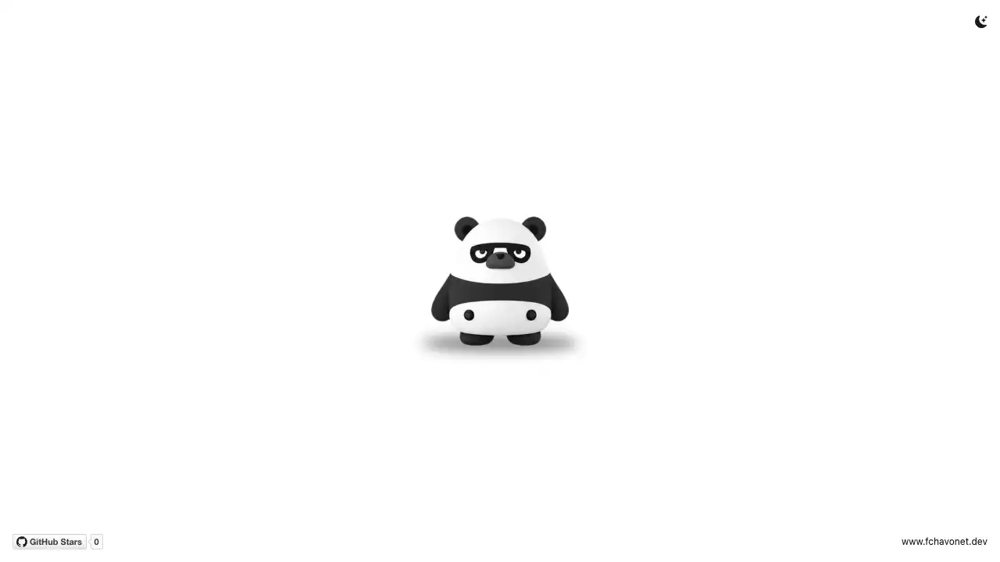

# Panda Mascot

## Description

## Description

Mascot is a creative coding project featuring an interactive panda that follows the mouse cursor and reacts with different facial expressions.

Inspired by [page-mascot](https://github.com/nilbuild/page-mascot) by [Kamran Ahmed](https://github.com/nilbuild), I created my own version as an experiment for my future personal portfolio, potentially as a website companion or animated chatbot assistant.

The panda is based on an a old [Xbox avatar](https://xbox.fandom.com/wiki/List_of_Xbox_One_gamerpics?file=63_-_T3PpZud.jpg) whose original artist I couldn't identify. Its illustrations were recreated using AI-assisted image generation and extensively refined in Adobe Photoshop.

The project is still a work in progress, with further visual improvements and features planned.

## Objectives

- Create a custom interactive panda mascot for my personal website.
- Make the panda follow the mouse cursor in eight different directions.
- Implement random facial expressions triggered by user interactions.
- Ensure smooth transitions between character states.
- Experiment with simple, lightweight character interactions using vanilla JavaScript.

## Tech Stack


![Photoshop badge](https://img.shields.io/badge/PHOTOSHOP-011e37?logo=data:image/svg+xml;base64,PCFET0NUWVBFIHN2ZyBQVUJMSUMgIi0vL1czQy8vRFREIFNWRyAxLjEvL0VOIiAiaHR0cDovL3d3dy53My5vcmcvR3JhcGhpY3MvU1ZHLzEuMS9EVEQvc3ZnMTEuZHRkIj4KDTwhLS0gVXBsb2FkZWQgdG86IFNWRyBSZXBvLCB3d3cuc3ZncmVwby5jb20sIFRyYW5zZm9ybWVkIGJ5OiBTVkcgUmVwbyBNaXhlciBUb29scyAtLT4KPHN2ZyBmaWxsPSIjZmZmZmZmIiB2ZXJzaW9uPSIxLjEiIHhtbG5zPSJodHRwOi8vd3d3LnczLm9yZy8yMDAwL3N2ZyIgeG1sbnM6eGxpbms9Imh0dHA6Ly93d3cudzMub3JnLzE5OTkveGxpbmsiIHdpZHRoPSI4MDBweCIgaGVpZ2h0PSI4MDBweCIgdmlld0JveD0iMCAwIDUxMiA1MTIiIGVuYWJsZS1iYWNrZ3JvdW5kPSJuZXcgMCAwIDUxMiA1MTIiIHhtbDpzcGFjZT0icHJlc2VydmUiIHN0cm9rZT0iI2ZmZmZmZiI+Cg08ZyBpZD0iU1ZHUmVwb19iZ0NhcnJpZXIiIHN0cm9rZS13aWR0aD0iMCIvPgoNPGcgaWQ9IlNWR1JlcG9fdHJhY2VyQ2FycmllciIgc3Ryb2tlLWxpbmVjYXA9InJvdW5kIiBzdHJva2UtbGluZWpvaW49InJvdW5kIi8+Cg08ZyBpZD0iU1ZHUmVwb19pY29uQ2FycmllciI+IDxnIGlkPSIyMDY5YTQ2MGRjZjI4Mjk1ZTIzMWYzMTExZTAzNzU1MiI+IDxwYXRoIGRpc3BsYXk9ImlubGluZSIgZD0iTTQyNi4zMzMsMC41SDg1LjY2N0MzOC44MjUsMC41LDAuNSwzOC44MjUsMC41LDg1LjY2N3YzNDAuNjY3YzAsNDYuODQyLDM4LjMyNSw4NS4xNjcsODUuMTY3LDg1LjE2NyBoMzQwLjY2N2M0Ni44NDIsMCw4NS4xNjctMzguMzI1LDg1LjE2Ny04NS4xNjdWODUuNjY3QzUxMS41LDM4LjgyNSw0NzMuMTc1LDAuNSw0MjYuMzMzLDAuNXogTTI0NS4zMjksMjYwLjUyNCBjLTE3LjczNiwxNy43MzYtNDUuNjExLDI2LjA2NS03Ny4xMDMsMjYuMDY1Yy04LjMyNiwwLTE1LjkyNy0wLjM2NS0yMS43Mi0xLjQ1MXY5MS45NDVoLTQ0LjE1OVYxMzYuMzYzIGMxNS45MjctMi44OTUsMzguMDA5LTUuMDY5LDY4LjA1LTUuMDY5YzMyLjU4MiwwLDU2LjQ3Myw2Ljg3OCw3Mi4wMzksMTkuOTExYzE0LjQ4LDExLjk0NywyMy44OSwzMS4xMzEsMjMuODksNTMuOTM2IEMyNjYuMzI1LDIyOC4zMDksMjU5LjA4NiwyNDcuNDkyLDI0NS4zMjksMjYwLjUyNHogTTMzNy45ODEsMzgwLjcwNmMtMjEuMzU4LDAtNDAuNTQyLTUuMDY5LTUzLjU3NC0xMi4zMWw4LjY4Ny0zMi4yMTYgYzEwLjEzNSw2LjE1NCwyOS4zMjIsMTIuNjcxLDQ1LjI0OSwxMi42NzFjMTkuNTQ1LDAsMjguMjM2LTcuOTY0LDI4LjIzNi0xOS41NDljMC0xMS45NDMtNy4yMzktMTguMDk5LTI4Ljk2LTI1LjcgYy0zNC4zOTEtMTEuOTQ3LTQ4Ljg2Ni0zMC43NjktNDguNTA1LTUxLjQwM2MwLTMxLjEzMSwyNS43LTU1LjM4Myw2Ni42MDQtNTUuMzgzYzE5LjU0OSwwLDM2LjU2Miw1LjA2OSw0Ni42OTUsMTAuNDk2IGwtOC42ODcsMzEuNDkzYy03LjYwMi00LjM0Mi0yMS43MjEtMTAuMTM1LTM3LjI4NS0xMC4xMzVjLTE1LjkyOCwwLTI0LjYxNSw3LjYwMi0yNC42MTUsMTguNDZjMCwxMS4yMjQsOC4zMjYsMTYuNjU1LDMwLjc3LDI0LjYxOCBjMzEuODU0LDExLjU4Miw0Ni42OTYsMjcuODcxLDQ3LjA1OCw1My45MzdDNDA5LjY1MywzNTcuNTM5LDM4NC42NzgsMzgwLjcwNiwzMzcuOTgxLDM4MC43MDZ6IE0yMjEuOCwyMDYuOTUgYzAsMjguNTk4LTIwLjI3Myw0NC44ODctNTMuNTc0LDQ0Ljg4N2MtOS4wNDksMC0xNi4yODktMC4zNjItMjEuNzItMS44MDl2LTgyLjUzNGM0LjcwOC0xLjA4NSwxMy4zOTUtMi4xNzEsMjUuNzA0LTIuMTcxIEMyMDIuOTc5LDE2NS4zMjMsMjIxLjgsMTc5LjgwMywyMjEuOCwyMDYuOTV6Ij4gPC9wYXRoPiA8L2c+IDwvZz4KDTwvc3ZnPg==&logoColor=white&style=for-the-badge)

## File Description

| **FILE**     | **DESCRIPTION**                                                                                          |
| :----------: | -------------------------------------------------------------------------------------------------------- |
| `assets`     | Contains the resources required for the repository.                                                      |
| `index.html` | Main HTML structure containing the mascot and interface elements.                                        |
| `style.css`  | Custom styles, theme adjustments, and the mascot's ground shadow.                                        |
| `script.js`  | JavaScript logic handling mouse tracking, facial expressions, image preloading, and responsive behavior. |
| `README.md`  | The README file you are currently reading 😉.                                                            |

## Installation & Usage

### Installation

1. Clone this repository:
    - Open your preferred Terminal.
    - Navigate to the directory where you want to clone the repository.
    - Run the following command:

```
git clone https://github.com/fchavonet/creative_coding-panda_mascot.git
```

2. Open the cloned repository.

### Usage

1. Open the `index.html` file in your web browser.
2. Move your mouse: the panda automatically follows the cursor using eight viewing directions.
3. Click the panda: a random facial expression appears for 1.5 seconds before the panda resumes following the cursor.

You can also test the project online by clicking [here](https://fchavonet.github.io/creative_coding-panda_mascot/).

<p align="center">
    <picture>
        <source media="(prefers-color-scheme: light)" srcset="./assets/screenshots/desktop_page_screenshot-light.webp">
        <source media="(prefers-color-scheme: dark)" srcset="./assets/screenshots/desktop_page_screenshot-dark.webp">
        
    </picture>
</p>

<table align="center">
    <tr valign="top">
        <td align="center">
                
        </td>
        <td align="center">
                
        </td>
        <td align="center">
                
        </td>
        <td align="center">
                
        </td>
        <td align="center">
                
        </td>
        <td align="center">
                
        </td>
         <td align="center">
                
        </td>
         <td align="center">
                
        </td>
    </tr>
</table>

## What's Next?

- Improve the visual consistency and quality of the panda illustrations.
- Add subtle animations to make the character feel more alive.
- Develop a mobile-friendly version with touch interactions.
- Explore additional emotions and interactive behaviors.
- Integrate the mascot into the next version of my personal portfolio.
- Experiment with using the panda as an animated chatbot assistant.

## Thanks

- A special thanks to [Kamran Ahmed](https://github.com/nilbuild) for the original [page-mascot](https://github.com/nilbuild/page-mascot) project that inspired this experiment.
- A big thank you to my friends Pierre and Yoann, always available to test and provide feedback on my projects.

## Author(s)

**Fabien CHAVONET**
- GitHub: [@fchavonet](https://github.com/fchavonet)
